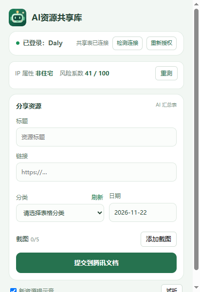
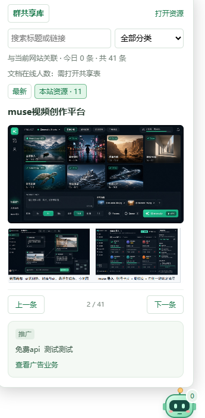
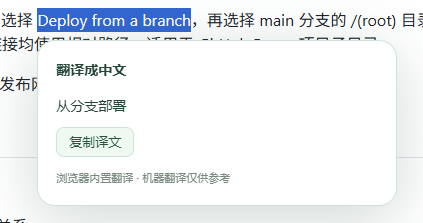
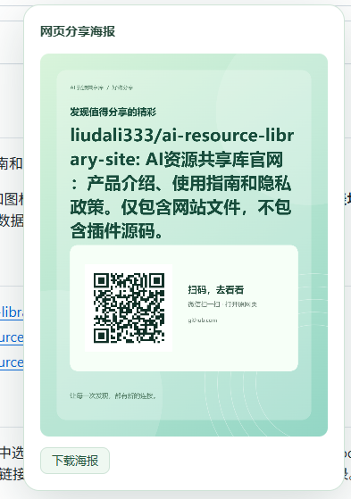

# AI资源共享库

浏览器扩展，帮助群友分享和浏览 AI 工具、教程与资源。

## 安装与了解

- [Chrome 应用商店](https://chromewebstore.google.com/detail/ojpmmcdmfidileddodgehlmgelgkglfb)
- [官网](https://liudali333.github.io/ai-resource-library-site/)
- [使用指南](https://liudali333.github.io/ai-resource-library-site/help/)
- [隐私政策](https://liudali333.github.io/ai-resource-library-site/privacy/)

## 功能

- 网页投稿：填写标题、链接和分类，可附加截图，直接提交到腾讯文档共享表。
- 悬浮机器人：浏览、搜索和翻页查看群资源，显示今日条数与更新提示。
- 网页工具：划词翻译、生成二维码分享海报。
- IP 检测：查看当前出口 IP 的网络属性和风险系数。
- 素材解析：在支持的平台页面解析视频或图文，下载可用素材。

功能以商店上架版本为准。腾讯文档功能使用个人授权，并受账号及文档权限限制。翻译、IP 检测和素材解析可能使用第三方服务，实际结果受服务与平台可用性影响。

## 功能截图

### 分享资源与 IP 检测

### 浏览共享资源

　

### 划词翻译与分享海报

　

### 素材解析

截图展示插件界面，功能和显示内容以实际安装版本为准。

## 关于本仓库

本仓库只包含公开网站文件，不包含插件源码、插件安装包或授权凭据。

反馈邮箱：1120374193@qq.com
